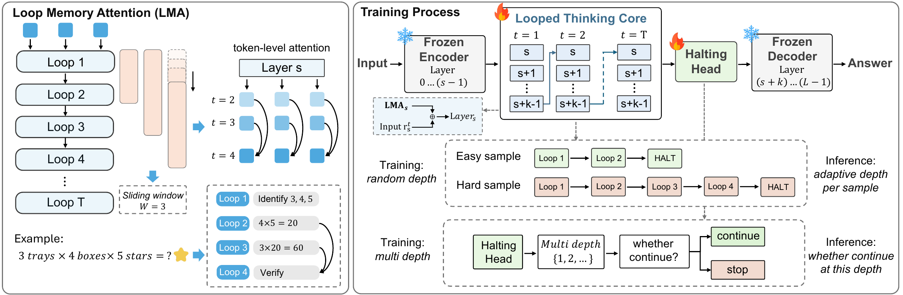
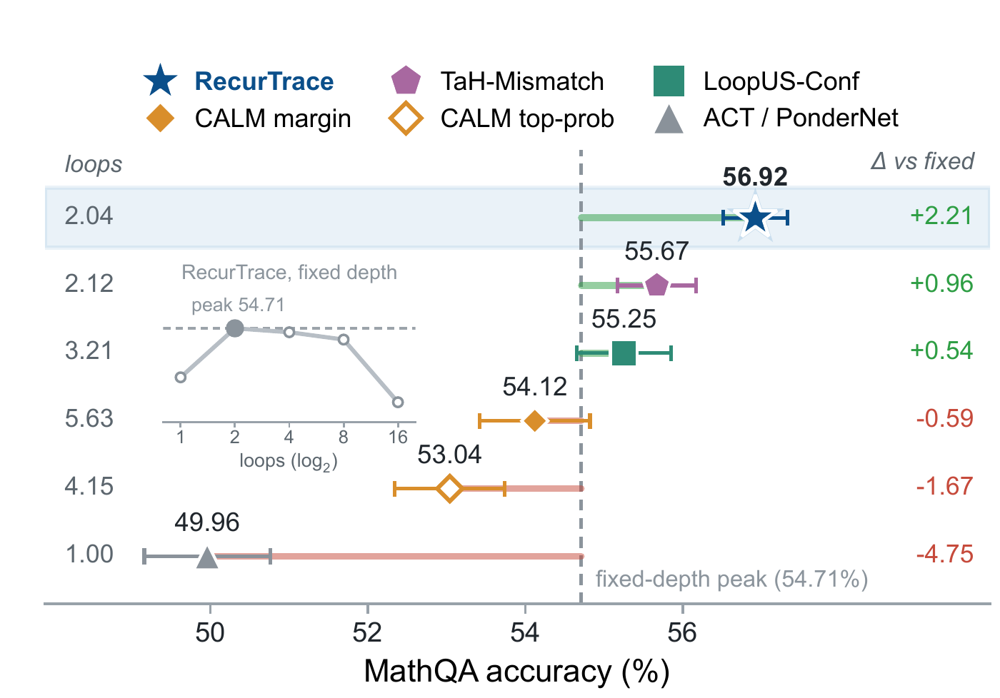

<div align="center">

# RecurTrace

**Adaptive Latent Reasoning with Loop-Time Memory**

<p>
  <a href="https://arxiv.org/abs/2609.03379"></a>
  &nbsp;
  <a href="LICENSE"></a>
</p>

**English** · [简体中文](README_zh-CN.md)

[Quick start](#quick-start) · [Adaptive depth](#adaptive-depth) · [Python API](#python-api) · [Results](#results-from-the-paper)

</div>

RecurTrace adds recurrent reasoning to a pretrained Qwen3 model. A shared block of layers revisits its earlier states through **Loop Memory Attention**, while a learned **halting head** chooses how much computation each input receives. One trained adapter supports multiple reasoning depths.

<p align="center">
  
</p>

<p align="center"><em>Loop-time memory and adaptive depth, with the pretrained backbone frozen.</em></p>

## Quick start

Use Python 3.10 or newer. The examples below use one CUDA GPU; add `--device cpu` to run on a CPU. Python 3.12 is recommended.

```bash
git clone https://github.com/JensenYX/RecurTrace.git
cd RecurTrace
python -m venv .venv
source .venv/bin/activate
python -m pip install -e .
```

Train a small adapter on the 32 arithmetic and state-tracking examples included in the repository. The public Qwen3 base model downloads automatically on the first run.

```bash
python train.py \
  --model Qwen/Qwen3-0.6B-Base \
  --data examples/train_manifest.json \
  --output outputs/stage1 \
  --max-steps 400 \
  --learning-rate 3e-4 \
  --gradient-accumulation 1 \
  --max-length 256
```

Generate an answer with two loops:

```bash
python generate.py \
  --adapter outputs/stage1 \
  --prompt "Program: x = 3; x += 4; x -= 2. What is the final value of x?" \
  --depth 2
```

The command prints JSON containing `answer` and `depth`:

```json
{"answer": "5", "depth": 2}
```

Change `--depth` to explore different loop counts. The example adapter teaches the workflow; use your task data for a trained reasoner.

`outputs/stage1` contains the adapter weights, its configuration, and the tokenizer. The frozen base is loaded separately. A local base-model directory also works with `--model`; pass the same directory when generating from an adapter trained locally.

## Train on your data

Use JSONL with one conversation per line. The final assistant message is the answer to learn:

```json
{"messages":[{"role":"system","content":"Answer with the final answer only."},{"role":"user","content":"What is 2 + 2?"},{"role":"assistant","content":"4"}]}
```

Pass the file directly to `--data`, or combine files with a JSON manifest. Paths are relative to the manifest; `weight` controls how much of each file is sampled per epoch.

```json
{"files":[{"path":"math.jsonl","weight":1.0},{"path":"state_tracking.jsonl","weight":1.0}]}
```

The default training recipe samples loop depths up to eight and optimizes only the loop-memory and input-injection modules. Increase `--max-length` to fit longer examples. `--epochs`, `--max-steps`, `--learning-rate`, `--batch-size`, and `--gradient-accumulation` control the training budget.

| Public base model | Loop start | Looped layers |
| :--- | :---: | :---: |
| `Qwen/Qwen3-0.6B-Base` | 12 | 3 |
| `Qwen/Qwen3-1.7B-Base` | 12 | 3 |
| `Qwen/Qwen3-4B-Base` | 15 | 3 |
| `Qwen/Qwen3-8B-Base` | 15 | 3 |

The block is selected automatically from the model configuration. Layer indices start at zero; `--loop-start` and `--loop-layers` let you choose another block.

For multiple GPUs, launch the same training script with `torchrun`. For example, this uses the bundled data with two GPUs:

```bash
torchrun --standalone --nproc_per_node=2 train.py \
  --model Qwen/Qwen3-0.6B-Base \
  --data examples/train_manifest.json \
  --output outputs/distributed \
  --max-steps 10 \
  --gradient-accumulation 1 \
  --max-length 256
```

## Adaptive depth

Train a halting head after training the loop adapter. First collect the answer losses at different depths and the corresponding prompt states:

```bash
python prepare_oracle.py \
  --adapter outputs/stage1 \
  --data examples/halting.jsonl \
  --output outputs/oracle \
  --max-length 256
```

Then fit the halting head:

```bash
python train_halting.py \
  --adapter outputs/stage1 \
  --oracle outputs/oracle \
  --output outputs/stage2
```

Generate with a depth selected from the prompt:

```bash
python generate.py \
  --adapter outputs/stage2 \
  --prompt "Program: x = 3; x += 4; x -= 2. What is the final value of x?" \
  --adaptive
```

The output includes the selected depth and continue probabilities. The defaults are `--min-depth 2`, `--max-depth 16`, and `--threshold 0.5`. Lower thresholds permit more loops. For your task, fit the head on training examples and choose the threshold on validation data. The selected depth is reused throughout the answer.

## Python API

```python
import torch
from transformers import GenerationConfig
from recurtrace import load_model, load_tokenizer

adapter = "outputs/stage1"
device = "cuda" if torch.cuda.is_available() else "cpu"
tokenizer = load_tokenizer(adapter=adapter)
model = load_model(adapter=adapter, device=device)

messages = [
    {"role": "system", "content": "Answer with the final answer only."},
    {"role": "user", "content": "What is 2 + 2?"},
]
prompt = tokenizer.apply_chat_template(
    messages, tokenize=False, add_generation_prompt=True, enable_thinking=False
)
inputs = tokenizer(prompt, add_special_tokens=False, return_tensors="pt").to(device)
config = GenerationConfig(
    max_new_tokens=32, do_sample=False, use_cache=False,
    pad_token_id=tokenizer.pad_token_id, eos_token_id=tokenizer.eos_token_id,
)
with torch.inference_mode():
    output = model.generate(**inputs, loop_count=2, generation_config=config)
print(tokenizer.decode(output[0, inputs.input_ids.shape[1]:], skip_special_tokens=True))
```

With a Stage 2 adapter, `model.choose_depth(**inputs)` returns the selected depth and continue probabilities. Pass that depth as `loop_count` to `generate`.

## Results from the paper

On MathQA with the 1.7B backbone, RecurTrace reaches **56.9% accuracy at 2.04 mean loops**, improving on the best fixed depth by **2.2 percentage points**.

<p align="center">
  
</p>

Across 22 tasks, fixed two-loop generation improves on the same-budget fine-tuned baselines at all four scales:

| Scale | Baseline | RecurTrace | Gain |
| :---: | ---: | ---: | ---: |
| 0.6B | 35.2% | **35.8%** | +0.6 pp |
| 1.7B | 44.8% | **46.0%** | +1.2 pp |
| 4B | 58.6% | **60.8%** | +2.2 pp |
| 8B | 66.6% | **70.0%** | +3.4 pp |

Figures and results are from the [paper](https://arxiv.org/abs/2609.03379).

## Citation

```bibtex
@article{wang2026recurtrace,
  title={RecurTrace: Adaptive Latent Reasoning with Loop-Time Memory},
  author={Wang, Yuxiang and Feng, Kunyu and Shen, Yingda and Xu, Haoning and Wang, Junyu and Wu, Zhizheng},
  journal={arXiv preprint arXiv:2609.03379},
  year={2026}
}
```

## License

[Apache-2.0](LICENSE). Built on [Qwen3](https://github.com/QwenLM/Qwen3) and [Hugging Face Transformers](https://github.com/huggingface/transformers).
